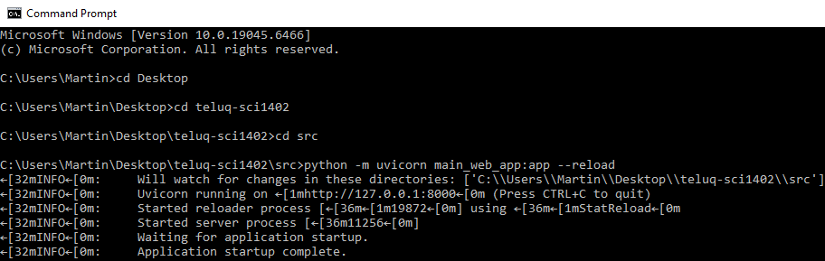
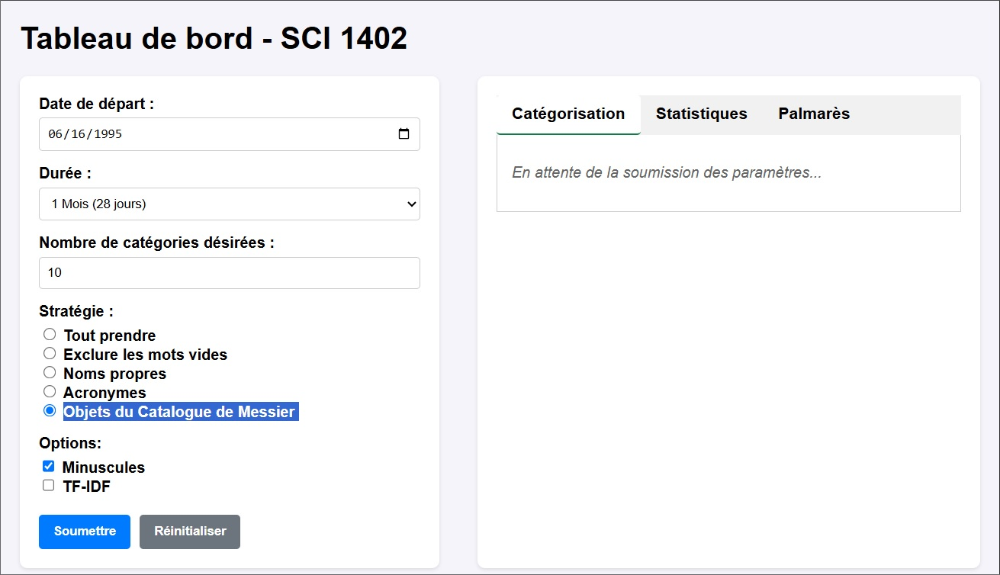
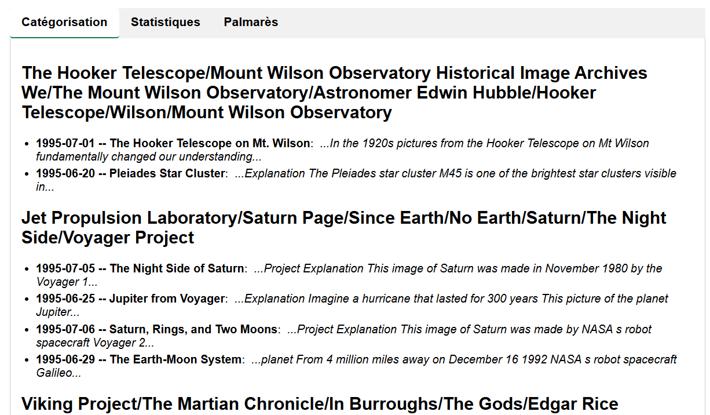
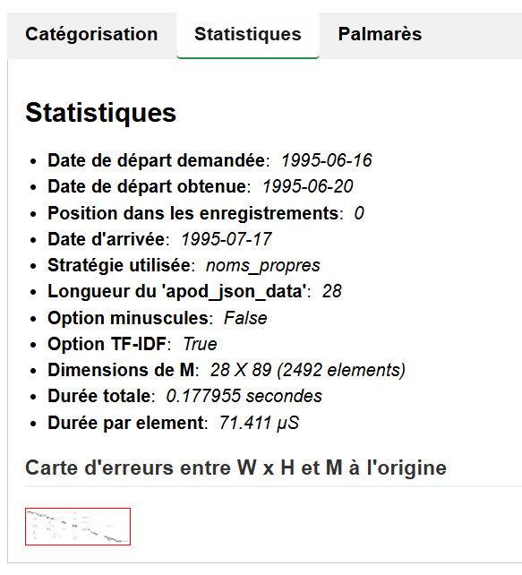
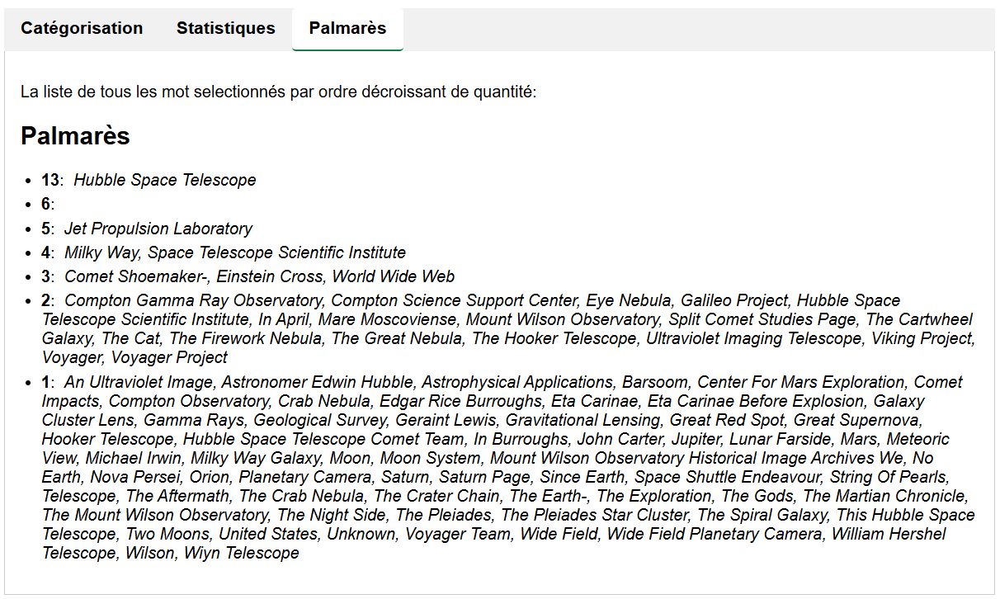

---
format:
  docx:
    reference-doc: TN3-custom-reference.docx
language:
  title-block-author-single: "Par"
  title-block-published: "Travail remis le"
title: Travail Noté 3 - Dépôt GIT et Dashboard
subtitle: TÉLUQ - SCI 1402 - Session automne 2026
date: today
date-format: "YYYY-MM-DD"
author: Martin Laplante (24121010)
jupyter: python3
bibliography: tn3.bib
lang: fr
csl: apa-fr-provost.csl
---


# &nbsp;
<!--page blanche-->

# Introduction

Ce document va décrire le code produit pour répondre aux objectifs du cours SCI 1402.

Afin de permettre un contrôle intuitif et d'apprécier les effets immédiats de la factorisation NMF une application imitant un tableau de bord style "Business Intelligence" (BI) a été développé.

Rappelons que la factorisation NMF consiste à produire deux matrices $W$ et $H$, qui, une fois multipliées ensemble fournit une approximation de $M$ la matrice à l'origine.

Les deux matrices $W$ et $H$ permettent de produire une catégorisation des articles trouvés sur le site "Astronomy Picture of the Day" offert par la NASA.

# Installation

Le dépôt GIT est [ici](https://github.com/martin-laplante/teluq-sci1402):

  * `https://github.com/martin-laplante/teluq-sci1402`

En supposant la version GIT mise à niveau, pour installer localement, on effectue la commande `git clone`:

  ```bash
  git clone https://github.com/martin-laplante/teluq-sci1402
  ```

  {#fig-git-clone}

Situé à la racine du projet, le fichier README.md fournis les quelques directives complémentaires en ce qui a trait aux librairies Python nécessaires et explique comment le projet est structuré.

# Utilisation

Le lancement du serveur Python s'effectue comme suit :

  * Sous Windows&trade; avec une invite de commande, changer de répertoire vers `./src` et effectuer la commande suivante :

    ```bash
    python -m uvicorn main_web_app:app --reload
    ```

  * Lorsque le message `Application startup complete.` apparait, le serveur est prêt à recevoir les requêtes :

    {#fig-srvr-strt}

  * Lancer Chrome sur l'URL suivante : <http://127.0.0.1:8000>

    {#fig-accueil-db}


## Paramètres d'entrée

### Date de départ

La date de départ définit le point de départ de la fenêtre sur laquelle les articles seront choisis

### Durée

Le nombre de jours désirés. Comme il y a un article par jour, environ, une sélection de périodes a été préétablie.

Il faut cependant comprendre cependant que la date d'arrêt à proprement parler n'aboutira pas exactement après la période sélectionnée. Par exemple, pour un trimestre, soit 90 jours, cela va correspondre à 90 jours d'articles. Si des articles dupliqués sont identifiés, la date d'arrêt sera forcément plus tard que trois mois après la date de départ. On veut des articles distincts. Le site APOD [@apod2026] ne s'en cache pas, certains articles sont volontairement reproduits plusieurs mois plus tard [^1]. L'effet est surtout visible avec des longues durées.

[^1]: Voir [@apod2026faq]

### Nombre de catégories désirées

La quantité de partitions effectuées sur les articles obtenus dans la période établie.

### Stratégie

Cette partie isole la façon dont chaque texte de chaque article sera traité.

| Nom | Effet | Implantation |
|-----|-------|--------------|
| Tout prendre | Tous les mots seront pris | Tout ce qui est capturé par l'expression régulière `r'[-\w]+'` |
| Exclure les mots vides. | L'option `Tout prendre` sans les mots vides.                         | La liste obtenue est filtrée par une liste interne. |
| Noms propres            | Retient que les noms propres pour placer dans la catégorisation.     | L'expression régulière `r'[A-Z][-a-z]+(\s+[A-Z][-a-z]+)+'` |2
| Acronymes               | Se spécialise dans les acronymes, souvent utilisés dans les articles | L'expression régulière `r"(?<=\()[-0-9A-Z]+(?=\))|[A-Z]{5,}|[BCDFGHJKLMNPQRSTVWXZ]{2,4}"` |
| Objets du Catalogue de Messier | Permet de repérer les sigles des objets célestes catalogués par Charles Messier. [@ObsParisMessier] offre un exemplaire. | L'expression régulière `r"Messier\s*\d+|(?<=\W)m\s*\d+(?=\W)"` |

### L'option minuscules

Fait une conversion de la chaine complète en lettre minuscule. De cette manière des mots comme ***`The`*** et ***`the`*** deviennent indiscernables sont regroupées en un seul terme.

### L'option TF-IDF

Permet d'appliquer sur la matrice à factoriser $M$, l'algorithme [TF-IDF](#acr-tfidf). Avec l'utilisation de cette option, on constate que la pertinence des résultats devient meilleure, car il tient compte de l'importance de chaque thème dans le corpus choisi.

## Fenêtres de résultats

Les résultats sont présentés en trois onglets.

1. Catégorisation
2. Statistiques
3. Palmarès

### Catégorisation

Cet onglet montre la catégorisation obtenue. Pour chaque catégorie (la liste en entête) on place les articles qui ont le meilleur pointage.

{#fig-catego1}

### Statistiques

Les statistiques offrent des mesures de temps et de quantité effectués lors de la plus récente opération.

Le cadre à bordure rouge montre l'erreur de reconstruction entre $W \times H$ et la matrice de départ $M$. Une reconstruction parfaite montrera un rectangle blanc. Une bonne quantité d'erreurs fera apparaitre des points gris un peu partout. La ligne diagonale est un artéfact dû à la manière dont la matrice $M$ d'origine est construite. Les articles sont ajoutés de haut en bas et chaque nouveau terme génère une colonne dans $M$ de gauche à droite.

{#fig-stats1}

### Palmarès

Fournis une liste en ordre décroissant de tous les termes capturés par la stratégie utilisée. Chaque item montre le nombre (en gras) et le terme (en italique) tel que repéré lors de la dernière opération.

{#fig-palmares1}

# Description des composantes

Ce qui suit décrit la vue d'ensemble des modules codés en Python. 

Afin de démarrer avec une base fonctionnelle pour l'application client/serveur, l'intelligence artificielle de Google/Gemini a été utilisée, ce qui a permis de concentrer les efforts de développement sur le cœur du projet. La discussion avec l'agent se trouve en annexe.

## Le serveur Python

Les fichiers Python suivant forment le cœur de l'application

| Fichier | Description                                          | Commentaires |
|:--------|:-----------------------------------------------------|:-------------|
| **`apodapp.py`**    | Principal de l'application. Effectue les appels nécessaires pour construire la réponse [JSON](#acr-json) |   |
| **`apodcsv2json`**  | Soutien pour la lecture du fichier CSV téléchargé depuis Kaggle [@kaggle2026] |   |
| **`config.py`**     | Configuration usager | |
| **`date2pos.py`**   | Soutien pour localiser la position de début de la sélection selon une date. | |
| **`main_web_app`**  | Point d'entrée de `FastAPI` | Généré automatiquement |
| **`stop_words.py`** | Soutien pour la stratégie `Exclure les mots vides`  | |
| **`strategies.py`** | Soutien pour l'ensemble des stratégies | Utilise les expressions régulières  |

## L'application client

* La structure HTML de l'application client se trouve dans `./src/templates/index.html`  quelques ajout ont été effectués notamment l'utilisation d'onglets pour améliorer la présentation des résultats.
* Le cœur des modifications se joue dans le fichier `./src/static/main_web_app.js`:
  - Construction de la commande au serveur.
  - Envoi et attente de la réponse
  - Inscription dans les éléments interne des éléments de réponses.

# Annexes

## Échanges avec l'agent de Gemini

### Question posée

```markdown
J'ai besoin de construire une application minimaliste "fullstack" qui agira sur un noyau Python que je développe en ce moment. Comme l'effort du projet repose principalement sur le noyau a développer, je veux un minimum de ramp-up pour son développement. Voici ce que j'aimerais concevoir: 

- coté client, une page Web qui se décline comme suit:
  - Une division, à gauche qui permet d'entrer les paramètres suivants
    * un champs d'entré d'une date
    * un champs d'entré du nombre de jours, avec des valeurs prédéfinies comme 7, 28, 90, 365 et 3653 pour une semaine, un mois, un trimeste une année et une décénie respectivement. 
    * un champs d'entrée d'un nombre, une quantité désirée. 
    * un ou deux radio buttons pour options style enumeration (a déterminer) 
    * un ou deux options box pour des flag boolean à mettre a true ou a false, avec valeurs par défaut 
    * un bouton submit. 
    * un bouton reset 
    * Quand le bouton submit est envoyé: 
      1. Une requete GET est formulé. Je veux voirs les paramètres dans l'URL 
      2. le serveur recois la requete et va faire un processus selon les parametre etablis 
      3. La reponse est renvoyée au client sous JSON. On veut pouvoir créer dynamiquement coté client une série de H3 (ou H4) avec sous chacun d'eux une liste "UL" - Une dvision vide à droite
    * Le JSON va permettre de remplir avec les résultat.
    * Ce code va accompagner un travail de session alors il sera cité en reference comme étant une contribution de l'IA au projet. 
    * Je ne veux qu'un squelette simple mais fonctionnel a partir duquel je vais ajouter ce qui manque.
```

### Réponse

```markdown
La solution la plus rapide et efficace pour votre besoin est d'utiliser FastAPI pour le serveur (Python) et du JavaScript natif (Vanilla JS) avec HTML/CSS pour le client.
Cette approche élimine complètement le besoin d'installer un framework front-end (comme React ou Vue) et minimise le ramp-up, car FastAPI génère automatiquement la documentation et s'intègre parfaitement avec votre noyau Python existant.

Voici le squelette complet, simple et fonctionnel, prêt à être cité pour votre travail de session.
```

**Note**: Pour garder la taille de ce document raisonnable, Le reste de la réponse se trouve dans le répertoire `./doc/dashboard%20-%20Prototype/contribution_ia_quarto.qmd` 

## Terminologie

| Acronyme | Description |
|:---------|:------------|
| [TF-IDF]{#acr-tfidf} | **T**erm **F**requency - **I**nverse **D**ocument **F**requency |
| [JSON]{#acr-json}    | **J**ava**S**cript **O**bject **N**otation |

## Références

